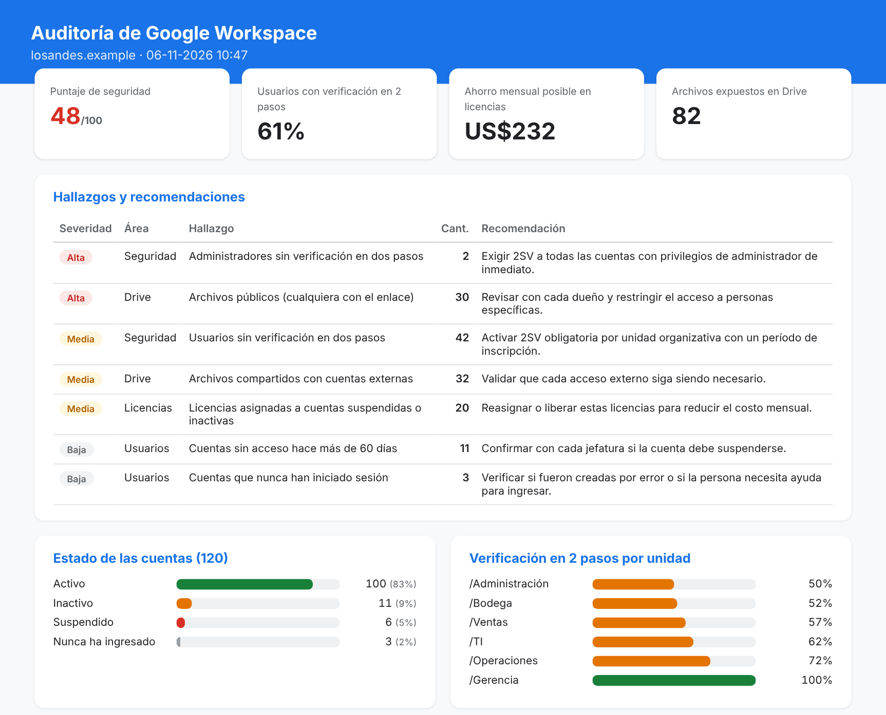

# 🛡️ Workspace Admin Kit

Kit en Python para **auditar y administrar Google Workspace**: detecta riesgos de seguridad, licencias pagadas que no se usan y archivos de Drive expuestos, y permite **crear usuarios en masa desde una planilla Excel** con validación previa.

Genera un informe para el cliente (HTML) y el detalle completo para trabajar (Excel).



> El informe de la imagen se generó en **modo simulado**, con un dominio ficticio de 120 usuarios y 420 archivos.

---

## El problema

En muchas pymes, Google Workspace lo administra "quien sabe un poco de computación". Con el tiempo se acumulan:

- **Cuentas de ex trabajadores** que siguen activas y **pagando licencia**.
- **Usuarios y administradores sin verificación en dos pasos**, la principal puerta de entrada para robo de cuentas.
- **Archivos públicos** o compartidos con correos personales: planillas de sueldos, bases de clientes, contratos.
- **Altas de usuarios hechas a mano**, una por una, con errores de nombre o en la unidad equivocada.

Revisar esto desde la consola de administración toma horas y no deja un informe que mostrar.

## Qué hace

### 1. Auditoría completa: `wskit auditar`

| Área | Qué revisa |
|---|---|
| **Seguridad** | Usuarios y administradores sin verificación en dos pasos, y su porcentaje por unidad organizativa |
| **Usuarios** | Cuentas activas, inactivas (sin acceso en más de N días), que nunca han ingresado o suspendidas |
| **Licencias** | Licencias asignadas a cuentas inactivas o suspendidas, y el **ahorro mensual posible** |
| **Drive** | Archivos públicos, compartidos con cuentas externas o visibles para todo el dominio |

Cada hallazgo incluye su **severidad** y una **recomendación concreta**, además de un **puntaje de seguridad de 0 a 100**.

### 2. Alta masiva de usuarios: `wskit alta-masiva planilla.xlsx`

Funciona en dos pasos para no cometer errores:

1. **Valida** cada fila, sin crear nada: usuario repetido o ya existente, caracteres no permitidos, unidad inexistente, licencia desconocida, datos faltantes.
2. Con `--aplicar`, **crea** solo las filas válidas, asigna la licencia y genera **contraseñas temporales seguras**, que el usuario debe cambiar en su primer ingreso.

```
INFO      Fila 2   OK     rocio.navarro@losandes.example
WARNING   Fila 7   ERROR  isidora.sepulveda@losandes.example -> El usuario ya existe en el dominio
WARNING   Fila 8   ERROR  agustin pizarro@losandes.example -> Usuario con caracteres no permitidos
WARNING   Fila 9   ERROR  trinidad.lagos@losandes.example -> La unidad /Marketing no existe
WARNING   Fila 13  ERROR  florencia.medina@losandes.example -> Licencia desconocida: Business Ultra
INFO    6 filas válidas, 6 con errores.
```

## Cómo probarlo (modo simulado, sin cuenta de Google)

```bash
pip install -e .
python scripts/generar_datos_simulados.py      # crea el dominio ficticio
wskit auditar                                   # informe en salida/ (HTML + Excel)
wskit alta-masiva data/ejemplo_altas.xlsx       # solo valida
wskit alta-masiva data/ejemplo_altas.xlsx --aplicar
```

Opciones útiles: `wskit auditar --dias 90` y `wskit auditar --sin-drive`.

## Conectar a un dominio real

El kit usa una **cuenta de servicio con delegación de todo el dominio**, el método recomendado por Google para automatizaciones de administración.

1. En [Google Cloud Console](https://console.cloud.google.com/), crea un proyecto y habilita **Admin SDK API**, **Enterprise License Manager API** y **Google Drive API**.
2. Crea una **cuenta de servicio** y descarga su clave JSON en `credenciales/` (esta carpeta está excluida de Git).
3. En la consola de administración de Google: **Seguridad → Acceso y control de datos → Controles de API → Delegación de todo el dominio**. Agrega el ID de cliente de la cuenta de servicio con estos permisos:
   ```
   https://www.googleapis.com/auth/admin.directory.user
   https://www.googleapis.com/auth/admin.directory.orgunit.readonly
   https://www.googleapis.com/auth/apps.licensing
   https://www.googleapis.com/auth/drive.readonly
   ```
4. Instala las librerías de Google y configura:
   ```bash
   pip install -e .[google]
   cp config.ejemplo.toml config.toml   # completa la sección [google] y los precios del contrato
   wskit --modo google auditar
   ```

> **Buenas prácticas:** la auditoría es de **solo lectura**. La alta masiva escribe en el dominio, así que primero corre siempre la validación. Las credenciales temporales se entregan por un canal seguro y luego se borra el archivo.

## Diseño

```
src/wskit/
├── clientes.py      # ClienteSimulado y ClienteGoogle: misma interfaz, distinto origen de datos
├── auditoria.py     # reglas de auditoría, hallazgos y puntaje
├── alta_masiva.py   # validación y creación de usuarios
├── reportes.py      # exportación a Excel y HTML
└── __main__.py      # línea de comandos (wskit)
```

Toda la lógica trabaja contra una **interfaz común**, así que lo que se prueba en modo simulado funciona igual contra la API real. Los datos simulados tienen **la misma estructura JSON** que devuelven las APIs de Google.

## Pruebas

```bash
pip install -e .[dev]
python -m pytest        # 25 pruebas
```

## Tecnologías

Python 3.11+ · pandas · openpyxl · Google Admin SDK (Directory API) · Enterprise License Manager API · Drive API v3 · pytest

---

> Todos los nombres, correos y archivos de este repositorio son **ficticios**. El dominio usa el sufijo reservado `.example`.

**¿Administras Google Workspace en tu empresa y quieres una auditoría?** Contáctame: clayer2001@gmail.com
